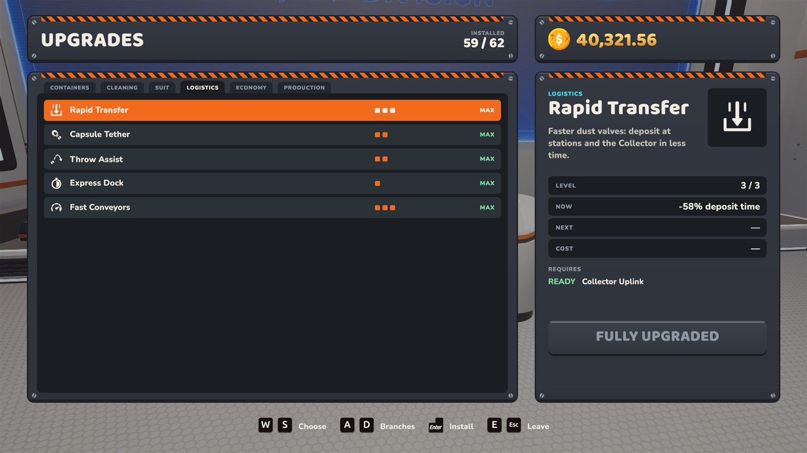
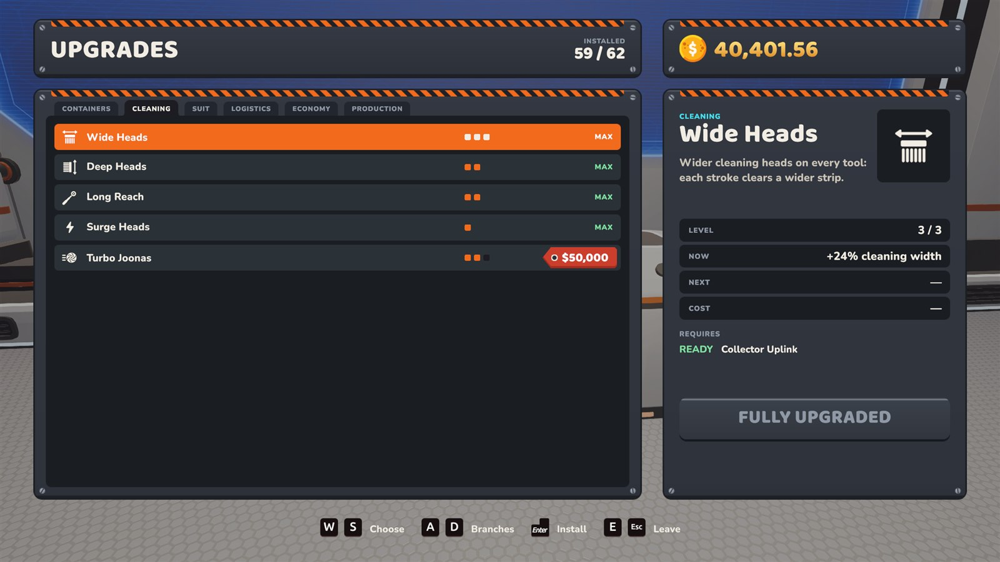
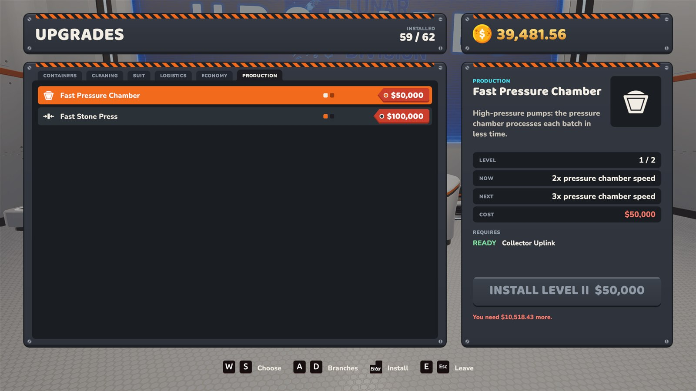
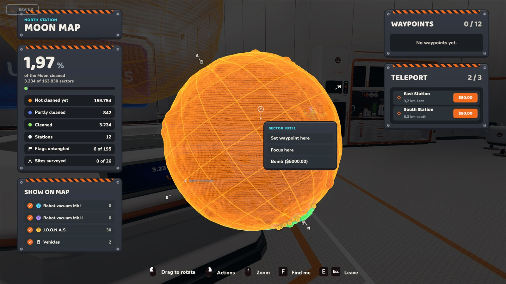
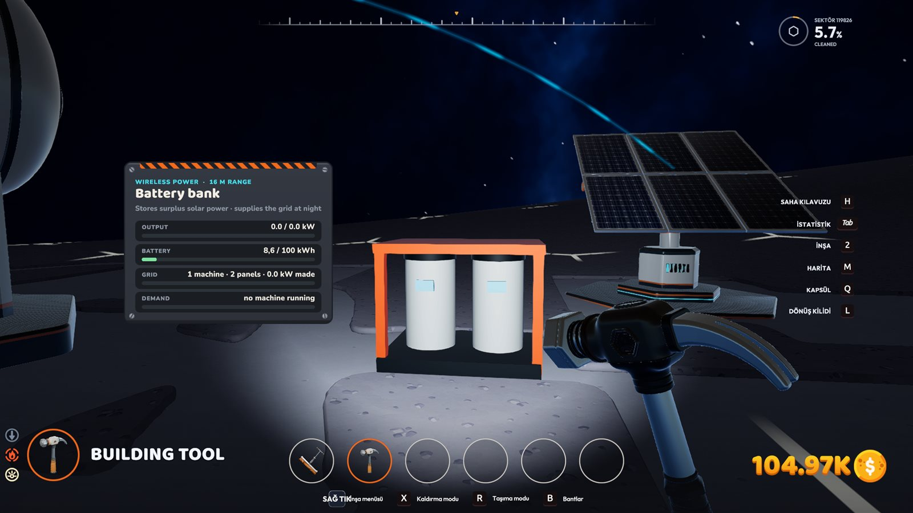
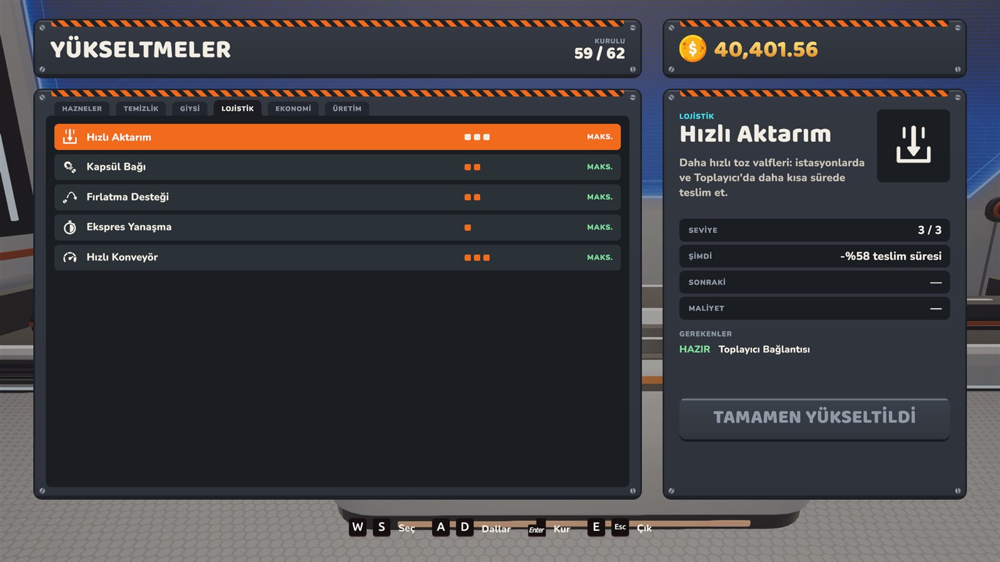
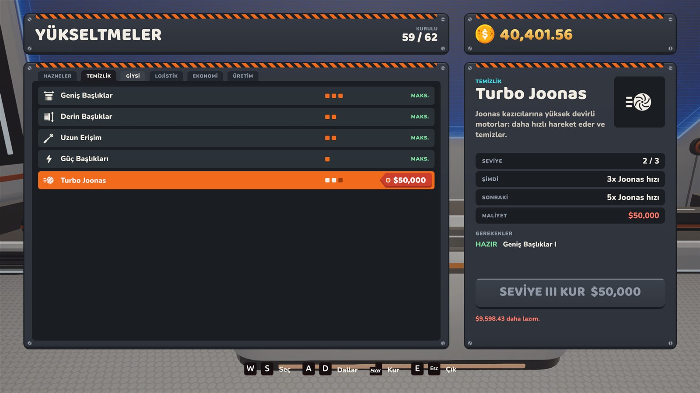
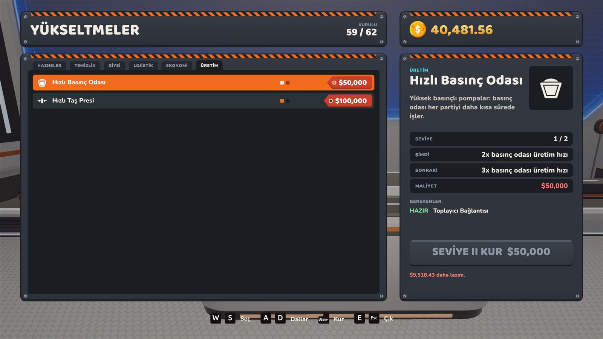
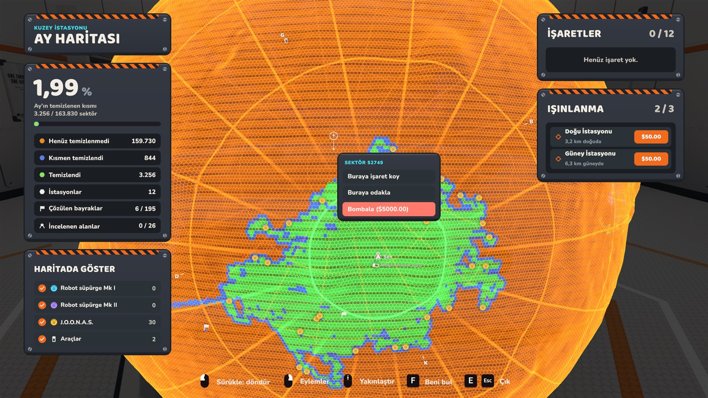
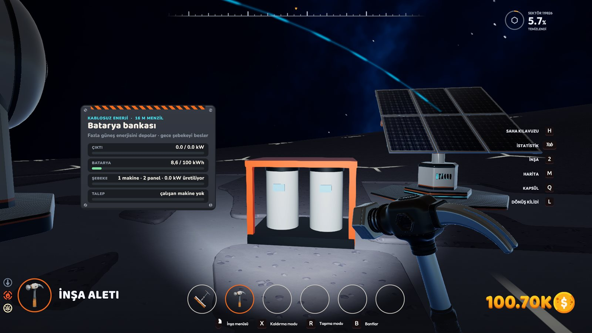

<a id="top"></a>

# Moon Sweepers Overdrive

<p align="center">
  <b><a href="#english">🇬🇧 English</a></b> &nbsp;|&nbsp; <b><a href="#turkce">🇹🇷 Türkçe</a></b>
</p>

---

<a id="english"></a>

## 🇬🇧 English

<sub>[🇹🇷 Türkçe'ye geç](#turkce)</sub>

A mod for **Moon Sweepers** that adds new purchasable upgrades to the upgrade tree, a buildable **Battery bank** for solar power storage and a "Bomb" option to the station's Moon map.

> ⚠️ Unofficial, fan-made mod. Not affiliated with the game's developer. Back up your saves before installing.

### ☕ Support

**If you enjoy the mod, you can support its development:**

<p><b>USDT (TRC20):</b> <b><code>TVosk9CuQNGR9hXyHZMm9kVz8mczLMkZGM</code></b></p>

> ⚠️ Send only USDT on the TRON (TRC20) network to this address.

### Features

| Feature | Where | Levels | Price |
|---|---|---|---|
| **Fast Conveyors**: every belt and machine output (capsule catcher, garage silo, packager, production) | Upgrade tree → Logistics | 2× / 3× / 5× | 1,000 / 5,000 / 10,000 |
| **Turbo Joonas**: Joonas diggers travel and clean faster (also while far away) | Upgrade tree → Cleaning | 2× / 3× / 5× | 10,000 / 20,000 / 50,000 |
| **Fast Pressure Chamber**: production cycle 12 s → 6 / 4 s | Upgrade tree → **Production** (new branch) | 2× / 3× | 20,000 / 50,000 |
| **Fast Stone Press**: production cycle 6 s → 3 / 2 s | Upgrade tree → **Production** (new branch) | 2× / 3× | 50,000 / 100,000 |
| **Bomb**: instantly completes an unfinished sector | Moon map → right-click | — | 5,000 |
| **Battery bank**: stores surplus solar power (100 kWh) and powers the grid at night | Build menu → Power | — | 160 (game's own price) |

All prices and multipliers can be changed in the settings file (see below).

#### Screenshots

|  |  |
|:---:|:---:|
| Logistics → **Fast Conveyors** | Cleaning → **Turbo Joonas** |
|  |  |
| New **PRODUCTION** branch | Moon map → right-click → **Bomb** |
|  | |
| Build menu → Power → **Battery bank** | |

#### Languages

Every text the mod adds follows the game's selected language: English, Türkçe, Deutsch, Français, Español, Italiano, Português, Polski, Русский, Українська, 日本語, 한국어, 简体中文, 繁體中文, Svenska, Suomi, Dansk, Norsk, Nederlands, Čeština. Unknown languages fall back to English.

Translations other than English and Turkish are machine-assisted. Corrections are welcome as an issue or PR (`src/strings.h`).

### Installation

1. Download the latest zip from the [Releases](../../releases) page and extract it.
2. Run `install.bat`. If the game is not in the default Steam folder, pass its path:
   ```
   install.bat "D:\SteamLibrary\steamapps\common\Moon Sweepers"
   ```
3. Start the game. The new upgrades appear in the upgrade tree.

`install.bat` copies two files into the game folder:
- `version.dll`: the mod
- `version_sys.dll`: a copy of Windows' own `version.dll`, which the mod forwards the real Windows functions to

**To uninstall**, run `uninstall.bat` or delete those two files. Save files are not touched. Steam's "Verify integrity of game files" does not remove these two files.

### Settings

`MoonSweepers_ConveyorMod.ini` is created in the game folder on first launch. Key names are Turkish: `Hiz` = speed multiplier, `Fiyat` = price, `Acik` = enabled.

```ini
[Konveyor]            ; Fast Conveyors
Hiz1=2
Hiz2=3
Hiz3=5
Fiyat1=1000
Fiyat2=5000
Fiyat3=10000
CikislarHizlansin=1   ; 0 = machine outputs keep their normal speed

[Joonas]              ; Turbo Joonas
Hiz1=2
Hiz2=3
Hiz3=5
Fiyat1=10000
Fiyat2=20000
Fiyat3=50000

[Bomba]               ; Bomb
Acik=1                ; 0 = no option in the map menu
Fiyat=5000

[Uretim]              ; Production (Basinc = pressure chamber, Pres = stone press)
BasincHiz1=2
BasincHiz2=3
BasincFiyat1=20000
BasincFiyat2=50000
PresHiz1=2
PresHiz2=3
PresFiyat1=50000
PresFiyat2=100000

[Aku]                 ; Battery bank
Acik=1                ; 0 = not in the build menu
KapasiteKwh=100       ; storage per battery bank
Fiyat=0               ; 0 = the game's own price
SarjCarpani=10        ; charging speed multiplier (1 = real time)
```

Changes apply after restarting the game. A debug log is written to `ConveyorMod.log` in the game folder.

### Good to know

- **Tied to the game version.** The mod patches machine code of a specific game build (Unity 6000.6.0f1) and verifies the expected code before every patch. If an update changes that code, the feature is skipped and `ATLANDI` ("skipped") is logged; the game is not broken. Some features may stop working after a game update until the mod is updated.
- **Saves:** purchased levels are stored by the game's own upgrade system. If the mod is removed, those levels simply have no effect.
- **Multiplayer:** tested in single player only. In multiplayer, everyone should use the same mod version, otherwise things may get out of sync.
- **Bomb** completes the sector with the game's own "complete region" function. No sector cleaning payout is given for bombed sectors.
- **Battery bank** is an unused structure that already ships with the game (model and card image); the mod adds it to the build menu. It joins the solar grid within 16 m and is charged from the panels' surplus. The blue power tethers are not drawn to the battery bank.

### How it works

The game is built with Unity IL2CPP, and its metadata version (v108) can't be read yet by the current modding tools (MelonLoader / BepInEx / Cpp2IL). So the mod talks to the IL2CPP runtime API directly, without any mod loader:

- It is loaded as a `version.dll` proxy; the real Windows functions are forwarded to `version_sys.dll`.
- New nodes and a new branch are added to the upgrade tree at runtime by growing the `MoonUpgradeTree.Nodes` / `BranchNames` arrays. Purchasing, prices and saving are handled by the game itself.
- Belt speed and output interval are constants compiled into the code, so the instructions that read them are redirected to the mod's own values.
- For Joonas, the pressure chamber and the stone press, the game's own speed fields are scaled by the purchased level.
- `MoonMapScreen.OpenMenu` is hooked to add the row to the map menu.
- The Battery bank is added to `MoonDepotBuilder`'s catalog, and the power solver is patched to treat it as a zero-output panel with a large battery. After each `MoonWorld.Update`, the grid's wasted solar surplus is moved into its battery banks.

### Building

Requires Visual Studio 2022 or Build Tools ("Desktop development with C++").

```
build.bat
```

Output: `build\version.dll`

### License

[MIT](LICENSE). Moon Sweepers and its assets belong to their respective owners; this repository contains only the mod's own code.

<sub>[⬆ Back to top](#top)</sub>

---

<a id="turkce"></a>

## 🇹🇷 Türkçe

<sub>[🇬🇧 Switch to English](#english)</sub>

Moon Sweepers için yükseltme ağacına yeni satın alınabilir yükseltmeler, güneş enerjisini depolayan inşa edilebilir bir **Batarya bankası** ve istasyonun Ay haritasına "Bombala" seçeneği ekleyen bir mod.

> ⚠️ Resmî olmayan, hayran yapımı bir moddur. Oyunun geliştiricisiyle bir bağlantısı yoktur. Kurmadan önce kayıtlarınızı yedekleyin.

### ☕ Destek

**Modu beğendiyseniz geliştirilmesine destek olabilirsiniz:**

<p><b>USDT (TRC20):</b> <b><code>TVosk9CuQNGR9hXyHZMm9kVz8mczLMkZGM</code></b></p>

> ⚠️ Bu adrese sadece TRON (TRC20) ağında USDT gönderin.

### Özellikler

| Özellik | Nerede | Seviyeler | Fiyat |
|---|---|---|---|
| **Hızlı Konveyör**: tüm bantlar ve makine çıkışları (kapsül yakalayıcı, garaj silosu, paketleyici, üretim) | Yükseltme ağacı → Lojistik | 2× / 3× / 5× | 1.000 / 5.000 / 10.000 |
| **Turbo Joonas**: Joonas kazıcıları daha hızlı hareket eder ve temizler (uzaktayken de) | Yükseltme ağacı → Temizlik | 2× / 3× / 5× | 10.000 / 20.000 / 50.000 |
| **Hızlı Basınç Odası**: üretim döngüsü 12 sn → 6 / 4 sn | Yükseltme ağacı → **Üretim** (yeni dal) | 2× / 3× | 20.000 / 50.000 |
| **Hızlı Taş Presi**: üretim döngüsü 6 sn → 3 / 2 sn | Yükseltme ağacı → **Üretim** (yeni dal) | 2× / 3× | 50.000 / 100.000 |
| **Bombala**: temizlenmemiş bir sektörü anında tamamlar | Ay haritası → sağ tık | — | 5.000 |
| **Batarya bankası**: fazla güneş enerjisini depolar (100 kWh) ve gece şebekeyi besler | İnşa menüsü (güneş panelleriyle aynı sekme) | — | 160 (oyunun kendi fiyatı) |

Bütün fiyatlar ve çarpanlar ayar dosyasından değiştirilebilir (aşağıya bakın).

#### Ekran görüntüleri

|  |  |
|:---:|:---:|
| Lojistik → **Hızlı Konveyör** | Temizlik → **Turbo Joonas** |
|  |  |
| Yeni **ÜRETİM** dalı | Ay haritası → sağ tık → **Bombala** |
|  | |
| İnşa menüsü → **Batarya bankası** | |

#### Diller

Modun eklediği tüm metinler oyunun seçili diline göre gösterilir: English, Türkçe, Deutsch, Français, Español, Italiano, Português, Polski, Русский, Українська, 日本語, 한국어, 简体中文, 繁體中文, Svenska, Suomi, Dansk, Norsk, Nederlands, Čeština. Bilinmeyen dillerde İngilizce kullanılır.

Türkçe ve İngilizce dışındaki çeviriler makine destekli olarak hazırlandı. Düzeltme önerisi için issue ya da PR açabilirsiniz (`src/strings.h`).

### Kurulum

1. [Releases](../../releases) sayfasından son sürümün zip dosyasını indirip bir klasöre açın.
2. `install.bat` dosyasını çalıştırın. Oyun varsayılan Steam klasöründe değilse yolu parametre olarak verin:
   ```
   install.bat "D:\SteamLibrary\steamapps\common\Moon Sweepers"
   ```
3. Oyunu başlatın. Yeni yükseltmeler ağaçta görünür.

`install.bat` iki dosyayı oyun klasörüne kopyalar:
- `version.dll`: mod
- `version_sys.dll`: Windows'un kendi `version.dll` dosyasının bir kopyası, modun gerçek Windows fonksiyonlarını ona yönlendirmesi için gerekli

**Kaldırmak için** `uninstall.bat` çalıştırın ya da bu iki dosyayı silin. Kayıt dosyalarına dokunulmaz. Steam'den "Dosyaların bütünlüğünü doğrula" bu iki dosyayı silmez.

### Ayarlar

İlk açılışta oyun klasöründe `MoonSweepers_ConveyorMod.ini` oluşur:

```ini
[Konveyor]
Hiz1=2
Hiz2=3
Hiz3=5
Fiyat1=1000
Fiyat2=5000
Fiyat3=10000
CikislarHizlansin=1   ; 0 = makine çıkışları normal hızda kalır

[Joonas]
Hiz1=2
Hiz2=3
Hiz3=5
Fiyat1=10000
Fiyat2=20000
Fiyat3=50000

[Bomba]
Acik=1                ; 0 = harita menüsüne seçenek eklenmez
Fiyat=5000

[Uretim]
BasincHiz1=2
BasincHiz2=3
BasincFiyat1=20000
BasincFiyat2=50000
PresHiz1=2
PresHiz2=3
PresFiyat1=50000
PresFiyat2=100000

[Aku]
Acik=1                ; 0 = inşa menüsüne eklenmez
KapasiteKwh=100       ; bir bataryanın depoladığı enerji
Fiyat=0               ; 0 = oyunun kendi fiyatı
SarjCarpani=10        ; şarj hızı çarpanı (1 = gerçek zaman)
```

Değişiklikler oyunu yeniden başlatınca geçerli olur. Hata ayıklama için oyun klasöründe `ConveyorMod.log` tutulur.

### Bilinmesi gerekenler

- **Sürüme bağlıdır.** Mod, oyunun belirli bir derlemesindeki makine kodu adreslerine dokunur (Unity 6000.6.0f1). Her yamadan önce beklenen kodu doğrular. Oyun güncellenip kod değişirse ilgili özelliği atlar ve log'a `ATLANDI` yazar, oyunu bozmaz. Güncellemeden sonra mod güncellenene kadar bazı özellikler çalışmayabilir.
- **Kayıtlar:** Satın alınan seviyeler oyunun kendi yükseltme sistemiyle kaydedilir. Mod kaldırılırsa bu seviyeler etkisiz kalır.
- **Çok oyunculu:** Sadece tek oyunculu oyunda test edildi. Çok oyunculu oyunda herkesin aynı mod sürümünü kullanması gerekir, aksi halde senkron sorunları olabilir.
- **Bombala**, sektörü oyunun kendi "bölgeyi tamamla" fonksiyonuyla tamamlar. Bombalanan sektör için sektör temizleme ödemesi alınmaz.
- **Batarya bankası**, oyunda hazır bulunan ama kullanılmayan bir yapıdır (modeli ve kart resmiyle). Mod onu inşa menüsüne ekler. 16 m içindeki güneş şebekesine katılır ve panellerin fazla enerjisiyle şarj olur. Mavi enerji ipleri bataryaya çizilmez.

### Nasıl çalışır?

Oyun Unity IL2CPP ile derlenmiş ve metadata sürümü (v108) mevcut mod araçlarıyla (MelonLoader / BepInEx / Cpp2IL) henüz okunamıyor. Bu yüzden mod, hiçbir mod yükleyiciye ihtiyaç duymadan doğrudan IL2CPP runtime API'sini kullanır:

- Oyuna `version.dll` proxy'si olarak yüklenir. Gerçek Windows fonksiyonları `version_sys.dll`'e yönlendirilir.
- Yükseltme ağacına yeni düğümler ve yeni bir dal, runtime'da `MoonUpgradeTree.Nodes` / `BranchNames` dizileri genişletilerek eklenir. Satın alma, fiyat ve kayıt işleri oyunun kendi sistemine kalır.
- Bant hızı ve çıkış aralığı derlenmiş koda gömülü sabitler olduğu için, bu sabitleri okuyan talimatlar modun kendi değişkenlerine yönlendirilir.
- Joonas, basınç odası ve taş presi için oyunun kendi hız alanları satın alınan seviyeye göre ölçeklenir.
- Harita menüsüne satır eklemek için `MoonMapScreen.OpenMenu` kancalanır.
- Batarya bankası `MoonDepotBuilder` kataloğuna eklenir. Enerji çözücüsü onu üretimi sıfır, bataryası büyük bir panel gibi görecek şekilde yamalanır. Her `MoonWorld.Update` sonrasında şebekede boşa giden güneş fazlası bataryalara aktarılır.

### Derleme

Visual Studio 2022 ya da Build Tools ("Desktop development with C++") gerekir.

```
build.bat
```

Çıktı: `build\version.dll`

### Lisans

[MIT](LICENSE). Moon Sweepers ve varlıkları sahiplerine aittir. Bu depo yalnızca modun kendi kodunu içerir.

<sub>[⬆ Başa dön](#top)</sub>
